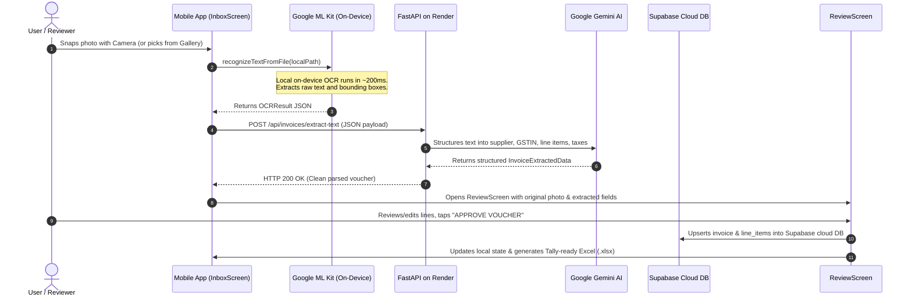

# BillBooks (Bill-to-Tally Automation Solution) - Complete Handover & Context Guide

> **Purpose of this document**: Provide a single, comprehensive reference file containing all project context, architecture, file mappings, execution flows, credentials, past bugs/fixes, deployment setup, and current working status so any AI assistant or developer can immediately pick up where you left off.

---

## 1. Project Overview & Business Logic

* **Product Name**: BillBooks (Tagline: *"PURCHASE VOUCHER AUTOMATION"*)
* **Client / Context**: Ashan Tech Labs / Origen Tech
* **Repository**: `https://github.com/HariniMuhilan/Bill-To-Tally-Automation-Solution.git`
* **Active Working Branch**: `frontend-redesign`
* **Core Problem**: Indian SMEs receive hundreds of supplier invoices each month. Typing supplier names, 15-digit GSTINs, line items, rates, taxes (CGST/SGST/IGST), and discounts into TallyPrime manually takes hours, causes typing errors, and risks loss of Input Tax Credit (ITC).
* **Core Workflow**: **Extract → Review → Approve → Post**
  1. **Capture**: User photographs a physical bill on a mobile phone (or selects a gallery image/PDF).
  2. **On-Device OCR**: Mobile app runs Google ML Kit (`google_mlkit_text_recognition`) locally on the phone in ~150–250ms with 0 server memory cost.
  3. **Cloud AI Extraction**: Raw extracted text is sent to the FastAPI backend on Render (`POST /api/invoices/extract-text`), which calls Google Gemini AI (`gemini-3.5-flash-lite`) to parse fields into structured JSON.
  4. **Review**: The mobile app displays the original photo side-by-side with editable fields, item lines, and confidence indicators.
  5. **Approval Gate**: User explicitly approves the voucher. It is compiled into an Excel workbook (`.xlsx`) structured for Tally Prime import and synced to Supabase.
  6. **Tally Posting**: Staged for Tally Prime via XML connector (`POSTING_ENABLED=False` safety default).

---

## 2. Directory Structure & Key Files

```text
d:\Origen Tech\billing system\
├── Bill-To-Tally-Automation-Solution\
│   ├── .python-version                # Pins Python 3.11.8 for cloud builds (Render)
│   ├── requirements.txt               # Root pointer redirecting to backend/requirements.txt
│   ├── app\                           # Root bridge package for cloud runners (uvicorn app.main:app)
│   │   ├── __init__.py                # App bridge initializer (sets sys.path)
│   │   └── main.py                    # Forwards app from backend.app.main
│   ├── main.py                        # Root entry point forwarding to backend.app.main
│   │
│   ├── backend\
│   │   ├── .python-version            # 3.11.8
│   │   ├── requirements.txt           # Lightweight cloud requirements (~45MB RAM footprint)
│   │   ├── .env                       # Live configuration (GEMINI_API_KEY, Tally configs)
│   │   ├── .env.example               # Template for configuration
│   │   ├── app\
│   │   │   ├── main.py                # FastAPI app, CORS, double-slash normalizer, health endpoints
│   │   │   ├── core\config.py         # Pydantic Settings (.env loader, directory initializer)
│   │   │   ├── api\routes\invoices.py # POST /ocr, POST /extract-text, GET /file/{filename}
│   │   │   ├── services\ocr_service.py# Adapter with lazy PaddleOCR / MockOCR & safe numpy imports
│   │   │   ├── services\extraction.py # Gemini extraction + rate limiter + regex fallback
│   │   │   └── schemas\invoice.py     # Pydantic schemas (Decimal arithmetic)
│   │   └── data\uploads\              # Uploaded bill images named by SHA-256 hash
│   │
│   ├── mobile_app\
│   │   ├── pubspec.yaml               # Flutter dependencies (google_mlkit, supabase_flutter, url_launcher)
│   │   ├── android\
│   │   │   ├── app\
│   │   │   │   ├── build.gradle.kts   # Android build config with R8 ProGuard linking
│   │   │   │   ├── proguard-rules.pro # R8 rules suppressing ML Kit optional language warnings
│   │   │   │   └── src\main\AndroidManifest.xml # Permissions (CAMERA, INTERNET, ML Kit auto-download)
│   │   ├── lib\
│   │   │   ├── main.dart              # Flutter entry point, Supabase initialization
│   │   │   ├── core\supabase_config.dart # Supabase client config & table constants
│   │   │   ├── models\invoice.dart    # Invoice & LineItem Dart models (toDoubleSafe)
│   │   │   ├── models\draft_sheet.dart# Draft Excel sheets model
│   │   │   ├── models\audit_log.dart  # Audit trail model
│   │   │   ├── models\user_session.dart# User session model
│   │   │   ├── services\api_service.dart# HTTP client for Render backend (extract-text & ocr)
│   │   │   ├── services\mlkit_service.dart # On-device Google ML Kit OCR text recognizer
│   │   │   ├── services\supabase_service.dart # Cloud authentication & database sync (invoices/line_items)
│   │   │   ├── services\storage_service.dart # Hardcoded Render URL & SharedPreferences cache
│   │   │   ├── services\excel_service.dart # Generates Excel .xlsx workbooks
│   │   │   ├── screens\login_screen.dart # Real email auth, early warnings, smart recovery cards
│   │   │   ├── screens\home_shell.dart # 4-tab shell with floating camera action button
│   │   │   ├── screens\inbox_screen.dart # Inbox, camera capture, streamlined loading copy
│   │   │   ├── screens\review_screen.dart # Review UI, line item grid, Supabase auto-sync
│   │   │   ├── screens\tally_connector_screen.dart # Draft Excel workbook manager
│   │   │   ├── screens\audit_trail_screen.dart # Log of all reviews, approvals, and edits
│   │   │   ├── widgets\liquid_glass.dart # Custom design system (frosted glass & liquid paint)
│   │   │   └── theme\app_theme.dart   # Brand color palette (Maroon, Orange, Cream)
│   └── venv\                          # Local Python virtual environment
└── docs\
    ├── PROJECT_HANDOVER.md            # This handover document
    └── assets\                        # Reference screenshots and branding assets
```

---

## 3. Cloud Production Deployments & Services

### A. Backend API (Render.com)
* **Live Production URL**: `https://bill-to-tally-automation-solution.onrender.com`
* **Free Tier Specs**: 750 free hours/month, 512MB RAM (our backend runs at ~45MB RAM).
* **Key Endpoints**:
  * `GET /api/health` &rarr; System status & configuration probe
  * `POST /api/invoices/extract-text` &rarr; Accepts JSON payload from mobile on-device ML Kit, runs Gemini structured parsing
  * `POST /api/invoices/ocr` &rarr; Fallback multipart image upload endpoint
  * `GET /docs` &rarr; Interactive Swagger UI documentation
* **Required Render Environment Variables**:
  * `GEMINI_API_KEY`: Active Google Gemini API Key
  * `GEMINI_MODEL`: `gemini-3.5-flash-lite`

### B. Cloud Database & Authentication (Supabase)
* **Project URL**: `https://fechwdczejepckkhbizm.supabase.co`
* **Publishable Client Key**: `sb_publishable_JkKCUhgqkhXb20YR-r2ZMw_tBYq-77z`
* **Authentication**: Real email/password sign-up and sign-in enabled.
* **Database Tables**:
  * `invoices`: `id`, `user_id`, `invoice_no`, `supplier_name`, `supplier_gstin`, `invoice_date`, `subtotal`, `tax_amount`, `grand_total`, `status`, `created_at`
  * `line_items`: `id`, `invoice_id`, `line_no`, `item_description`, `hsn_sac_code`, `quantity`, `unit_price`, `taxable_amount`, `gst_rate`, `total_amount`

### C. Mobile App (Android Release APK)
* **Compiled APK Location**:
  `d:\Origen Tech\billing system\Bill-To-Tally-Automation-Solution\mobile_app\build\app\outputs\flutter-apk\app-release.apk`
* **File Size**: ~82.5 MB
* **Configuration**: Hardcoded to `https://bill-to-tally-automation-solution.onrender.com` out of the box. No manual server URL entry or IP setup required by end users.

---

## 4. End-to-End Execution Sequence (How It Works)



---

## 5. Critical Technical Solutions & Bug Fixes Applied

1. **Lightweight Backend Decoupling for Free Cloud Hosting**:
   * Previously, running heavy C++ OCR libraries (`paddlepaddle` / `paddleocr`) on the server consumed 850MB+ RAM, causing instant OOM crashes on free hosting tiers (Render/Railway).
   * Decoupled server OCR in favor of mobile on-device **Google ML Kit** (`google_mlkit_text_recognition`). Backend memory dropped to ~45MB RAM, fitting permanently within free hosting.

2. **Render Python Version Pinning (Python 3.14 Alpha Bug)**:
   * Render defaulted to an unreleased alpha (Python 3.14.10), breaking C-extensions (`greenlet`, `pycore_frame.h`).
   * Pinned `.python-version` to `3.11.8` at the repository root and in `backend/`, and removed unused `greenlet`/`sqlalchemy` dependencies.

3. **Render Root Bridge & Missing `app` Module**:
   * Render executes `uvicorn app.main:app` from the repo root where files were nested inside `backend/app`.
   * Created root-level bridge entry points (`app/__init__.py`, `app/main.py`, and `main.py`) forwarding to `backend.app.main`, resolving `ModuleNotFoundError: No module named 'app'`.

4. **Missing `numpy` Dependency & Safe Imports**:
   * Decoupling `paddleocr` removed transitive `numpy` imports, causing runtime crashes when loading `ocr_service.py`.
   * Added `numpy>=1.26.0` to `backend/requirements.txt` and wrapped all image array conversions in defensive `try...except ImportError` blocks.

5. **Elimination of Trailing / Duplicate Slash 404s**:
   * Entering or appending paths with trailing slashes produced `//api/invoices/...` which FastAPI rejected with HTTP 404.
   * Fixed in mobile app (`storage_service.dart` and `api_service.dart`) by stripping trailing slashes with `.replaceAll(RegExp(r'/+$'), '')`.
   * Added Starlette middleware in `backend/app/main.py` that automatically collapses duplicate slashes.

6. **Permanently Locked Production URL & Cache Purge**:
   * Removed manual "Backend URL" settings buttons from both `LoginScreen` and `HomeShell`.
   * Hardcoded `apiBaseUrl` in `storage_service.dart` directly to `https://bill-to-tally-automation-solution.onrender.com`.
   * Added automatic purging of legacy SharedPreferences keys (`_keyApiBase`) on app start to prevent old debug IPs or broken URLs from persisting across app updates.

7. **Streamlined User-Facing Scanning Copy**:
   * Cleaned up `inbox_screen.dart` loading copy by removing technical jargon ("Google ML Kit", "on-device", "Gemini AI").
   * Now presents business-friendly messages: *"Reading invoice..."*, *"Scanning bill details..."*, and *"Processing voucher..."*.

8. **Enhanced Login UI & Smart Account Recovery**:
   * Swapped legacy username field for clean email address authentication.
   * Added real-time inline validation (email format regex, password $\ge$ 6 characters, password match check).
   * Added smart, contextual recovery warning banners:
     * Unregistered email &rarr; Amber card: *"Account Not Found or Incorrect Password"* with a 1-tap **"CREATE AN ACCOUNT"** button pre-filling their email.
     * Already registered email &rarr; Blue card with a 1-tap **"SIGN IN INSTEAD"** button.
     * Clear guidance for unconfirmed emails and network drops.

9. **Android Release APK Compilation & R8 ProGuard Rules**:
   * Upgraded/pinned `url_launcher_android: 6.3.14` in `pubspec.yaml` dependency overrides to remove deprecated Flutter v1 `PluginRegistry.Registrar` references while avoiding Gradle Kotlin DSL compiler conflicts.
   * Configured `android/app/proguard-rules.pro` and linked it in `android/app/build.gradle.kts` to suppress R8 minification warnings for optional Google ML Kit language scripts (`com.google.mlkit.vision.text.**`), allowing `flutter build apk` to compile cleanly to `app-release.apk` (82.5 MB).

---

## 6. How to Run & Test

### A. Run Backend Locally
```powershell
cd "d:\Origen Tech\billing system\Bill-To-Tally-Automation-Solution\backend"
..\venv\Scripts\uvicorn app.main:app --host 0.0.0.0 --port 8000 --reload
```

### B. Compile Release APK
```powershell
cd "d:\Origen Tech\billing system\Bill-To-Tally-Automation-Solution\mobile_app"
flutter build apk
# Output: build\app\outputs\flutter-apk\app-release.apk
```

### C. Git Management
* All work is committed to branch `frontend-redesign`.
* Push command:
  ```powershell
  cd "d:\Origen Tech\billing system\Bill-To-Tally-Automation-Solution"
  git push origin frontend-redesign
  ```

---

## 7. Prompt to Resume Next AI Session

When starting a new conversation, paste this prompt:

> *"I am continuing work on the BillBooks project (Bill-to-Tally Automation Solution). Please read `d:\Origen Tech\billing system\docs\PROJECT_HANDOVER.md` to get full context on the architecture, Render cloud deployment, Supabase setup, recent fixes, and current status before proceeding."*
